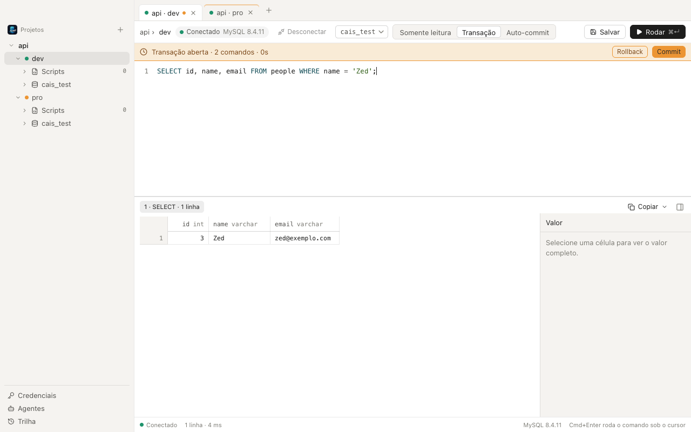
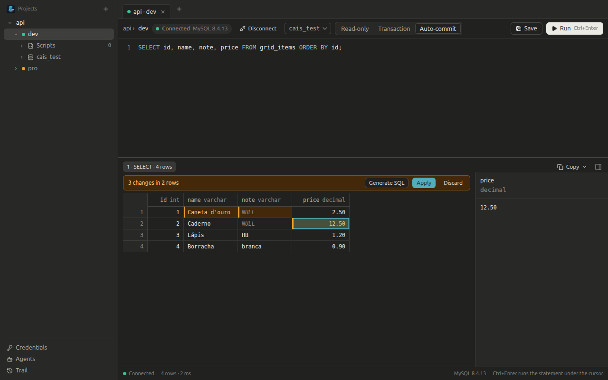

# Cais

Cais é um cliente SQL de desktop para MySQL, feito com Electron, React e TypeScript. Ele organiza os bancos por projeto e ambiente (dev, hml, produção), reaproveita a mesma credencial em vários ambientes e entra no Cloud SQL do Google por IAM, com a conta do `gcloud`, sem proxy rodando à parte. É seguro por padrão: produção abre em somente leitura, transação é um modo da aba e não um ajuste escondido, e agentes de IA acessam os bancos por um CLI próprio (`cais llm`), com a aprovação da pessoa no app e sem nunca receber senha, token ou host.



## Funcionalidades

- **Projetos, ambientes e credenciais.** Cada projeto tem seus ambientes (host, porta, banco padrão, marcação de produção). Uma credencial é um cadastro próprio, usado por quantos ambientes precisar: usuário e senha (cifrada no cofre do sistema) ou Google IAM via `gcloud`, com impersonação opcional de service account.
- **Login IAM no Cloud SQL.** Token de `gcloud sql generate-login-token`, plugin `mysql_clear_password` e TLS obrigatório. O Cais só lista as contas logadas e gera o token; nunca altera o `gcloud`.
- **Sessão por aba em três modos:** Somente leitura, Transação e Auto-commit. Produção abre em Somente leitura, Auto-commit em produção pede confirmação, e fechar uma aba com transação aberta pergunta antes (com Rollback como padrão).
- **Somente leitura de verdade**, em duas camadas: uma lista do que é permitido no app e a sessão em `READ ONLY` no servidor, reafirmada antes de cada comando.
- **Editor SQL** (CodeMirror 6) com realce do MySQL e autocomplete de palavras-chave, bancos, tabelas, colunas e apelidos.
- **Resultados em grade virtualizada**: até 1.000 linhas por comando, com "Buscar até 50.000", cancelamento pelo servidor (`KILL QUERY`), painel com o valor completo da célula e cópia em TSV, CSV ou JSON.
- **Edição na grade**: altere células de um resultado de uma tabela com a chave primária inteira e gere o `UPDATE` equivalente ou aplique na própria aba, respeitando o modo da sessão.
- **Estado da conexão em cada aba** (desconectado, conectando, conectado, executando, erro), com Conectar, Reconectar e Desconectar, e desconexão por inatividade depois de 30 minutos (nunca com transação aberta).
- **Scripts salvos por projeto**, listados dentro de cada ambiente do projeto, com botão Salvar, Cmd+S e seletor por Cmd+O.
- **Duplicar ambiente e projeto, renomear projeto.**
- **Trilha**: tudo o que roda no Cais, pela pessoa e pelos agentes, num arquivo por dia, por 90 dias, com cada linha encadeada por HMAC. Nunca guarda dados de resultado.
- **Proteção do cadastro**: o que decide para onde vai a credencial e o quanto um agente faz sozinho é assinado com uma chave do cofre do sistema; um ambiente alterado fora do Cais abre bloqueado.
- **Acesso de agentes** pelo CLI `cais llm`, com três níveis por ambiente, aprovação no app, Commit ou Rollback da pessoa para escritas e escrita em produção sempre com aprovação.
- **Interface em português (pt-BR) e inglês**, no idioma do sistema, e em tema claro ou escuro, seguindo o sistema.

| Edição na grade | Pedido de agente |
|---|---|
|  |  |


## Requisitos

- Node 20.19 ou mais novo e npm.
- Docker, só para `npm run integration` e `npm run e2e`: eles sobem e removem sozinhos um container `mysql:8.4` chamado `cais-test-*`, em porta aleatória.
- Para entrar no Cloud SQL por IAM: o Google Cloud SDK (`gcloud`) instalado e com a conta logada, e a instância preparada (veja [Login IAM no Cloud SQL](docs/comportamento.md#login-iam-no-cloud-sql)).

O empacotamento configurado gera o app para macOS em Apple Silicon (arm64). O código tem caminhos próprios para Windows e Linux (o socket dos agentes vira named pipe no Windows e o menu tem variante para esses sistemas), mas não há alvo de empacotamento para eles: rode pelo código-fonte (`npm run dev`).

## Instalar e rodar em desenvolvimento

```bash
npm install
npm run dev
```

## Testes

```bash
npm run typecheck              # tipos, nos projetos do main e do renderer
npm run unit                   # unitários (sem Docker)
npm run integration            # MySQL 8.4 real em container de teste (precisa do Docker)
npm run build && npm run e2e   # interface de ponta a ponta com Electron (abre janelas; precisa do Docker)
npm run check                  # tudo, na ordem: typecheck, unit, integration, build, e2e
```

O e2e grava capturas de tela em `tests/e2e/screenshots/` (fora do controle de versão; as imagens deste README ficam em `docs/images/`).

## Empacotar

```bash
npm run dist
```

Gera, para macOS em Apple Silicon:

- `dist/Cais-<versão>-arm64.dmg`
- `dist/mac-arm64/Cais.app`

### Abrir o app sem assinatura no macOS

O `.app` tem só uma assinatura ad-hoc local, sem Apple Developer ID e sem notarização. Aberto direto da pasta `dist/`, ele roda normalmente. Se o arquivo passar por download, AirDrop ou outro Mac, o macOS o coloca em quarentena e o Gatekeeper bloqueia a primeira abertura:

1. Arraste o `Cais.app` do `.dmg` para `Aplicativos`.
2. Clique com o botão direito no app, escolha **Abrir** e confirme em **Abrir**. Ou vá em **Ajustes do Sistema › Privacidade e Segurança** e use **Abrir mesmo assim**.
3. Pelo terminal: `xattr -dr com.apple.quarantine /Applications/Cais.app`.

Na primeira vez que você salvar uma senha, o macOS pode pedir acesso ao Keychain: é o cofre onde o Cais guarda as senhas cifradas e a chave de assinatura do cadastro.

## Uso

1. Em **Credenciais** (rodapé da barra lateral), cadastre uma credencial: usuário e senha, ou Google IAM (conta escolhida entre as logadas no `gcloud`; o usuário do banco é derivado do e-mail e pode ser editado).
2. Pelo **+** da barra lateral, cadastre um projeto e um ambiente com host, porta, banco padrão (opcional) e a credencial. **Produção** vem marcado quando o nome é `pro`, `prod` ou `production`, e pode ser trocado. **Testar conexão** confere antes de salvar.
3. Clique no ambiente: abre (ou foca) uma aba conectada a ele. Escreva a query e rode.

Na barra da aba ficam o ambiente, o estado da conexão, o banco atual, o modo (Somente leitura · Transação · Auto-commit), Salvar e Rodar. Com transação aberta, aparece a barra "Transação aberta · N comandos · tempo" com **Commit** e **Rollback**.

| Atalho | O que faz |
|---|---|
| Cmd+Enter | Roda o comando sob o cursor (ou a seleção) |
| Cmd+Shift+Enter | Roda todos os comandos do editor |
| Cmd+. | Cancela o comando em execução |
| Cmd+T | Nova aba (seletor "projeto · ambiente") |
| Cmd+W | Fecha a aba |
| Cmd+S / Cmd+Shift+S | Salva o script / salva como outro script |
| Cmd+O | Abre um script salvo |

Fora do macOS, Ctrl faz o papel de Cmd. O comportamento completo de cada tela, com os motivos, está em [docs/comportamento.md](docs/comportamento.md).

## Para agentes

Agentes de IA com shell (Claude Code e outros) consultam e, com a sua aprovação, corrigem dados pelo comando `cais llm`. O agente **pede** e você decide no Cais; o Cais não entrega senha, token nem host ao comando.

1. No Cais, abra **Agentes** (rodapé da barra lateral) e ligue **Acesso de agentes**. Começa desligado, e desligado o socket nem existe.
2. Menu **Cais › Instalar comando cais no terminal** (no Linux, menu **Arquivo**): cria o link `cais` em `/usr/local/bin` ou em `~/.local/bin`. O comando roda no Node do sistema (20 ou mais novo). No Windows, rode `node <caminho>/cais.mjs`.
3. Dê ao agente a skill [skills/cais/SKILL.md](skills/cais/SKILL.md) e, no Claude Code, a permissão `Bash(cais llm:*)`.

```bash
cais llm guide
cais llm envs
cais llm query loja/dev --sql "SELECT id, status FROM pedidos LIMIT 10"
cais llm query loja/dev --write --sql "UPDATE pedidos SET status = 'cancelado' WHERE id = 42" --reason "Pedido duplicado pelo cliente" --wait
```

Cada ambiente define o que um agente roda sem pedir (Tudo com aprovação; Leitura liberada, escrita com aprovação; Leitura e escrita liberadas). Em produção, escrita de agente sempre pede aprovação. A referência completa (comandos, saída JSON, códigos de saída, limites) está em [docs/agentes.md](docs/agentes.md).

## Segurança

- Senhas e tokens não saem do processo principal: a interface envia a senha uma vez, ao salvar, e nunca a recebe de volta. Senhas ficam cifradas pelo cofre do sistema (Keychain no macOS).
- O renderer roda isolado (`contextIsolation`, `sandbox`, CSP restritiva, nenhum recurso remoto). O processo principal valida tudo o que chega com zod e reclassifica o SQL antes de executar.
- O Cais recusa abrir com opções de depuração remota (só o gancho de testes de ponta a ponta as aceita), e o app empacotado não tem DevTools.
- Agentes falam com o Cais por um socket local só do usuário (modo 0600), nunca recebem credencial, e cada pedido é reclassificado e registrado na Trilha antes de rodar.
- Um agente sem sandbox, rodando como o mesmo usuário, não é contido pelo app. Para bancos de produção, rode o agente com sandbox e permita só `cais llm`.

O modelo de ameaças, as regras do classificador e os limites conhecidos estão em [docs/seguranca.md](docs/seguranca.md).

## Documentação

| Documento | Conteúdo |
|---|---|
| [docs/comportamento.md](docs/comportamento.md) | Como o Cais se comporta e por quê: modos, produção, abas, resultados, edição na grade, scripts, Trilha, cadastro |
| [docs/agentes.md](docs/agentes.md) | Referência do CLI `cais llm` para agentes |
| [docs/seguranca.md](docs/seguranca.md) | Modelo de segurança e de ameaças |
| [docs/arquitetura.md](docs/arquitetura.md) | Processos, módulos, contratos, arquivos e empacotamento |
| [AGENTS.md](AGENTS.md) | Guia para quem contribui com o código (pessoas e agentes) |

## Estrutura do projeto

```
src/
  main/       processo principal: sessões, drivers, cadastro, cofre, Trilha, acesso de agentes, IPC
  preload/    ponte tipada (window.cais) entre o renderer e o main
  renderer/   interface em React
  shared/     TypeScript puro usado pelos dois lados: modelo, dialeto MySQL, contrato de IPC, i18n
  cli/        o comando cais llm (empacotado num arquivo só, sem dependências)
tests/        unit, integration (MySQL em container) e e2e (Playwright com Electron)
scripts/      empacotamento do CLI e assinatura ad-hoc do app
skills/cais/  skill para agentes usarem o CLI
build/, resources/  ícones do app
```

Para contribuir, leia o [AGENTS.md](AGENTS.md): regras do projeto, convenções e comandos.

## Licença

[MIT](LICENSE).
