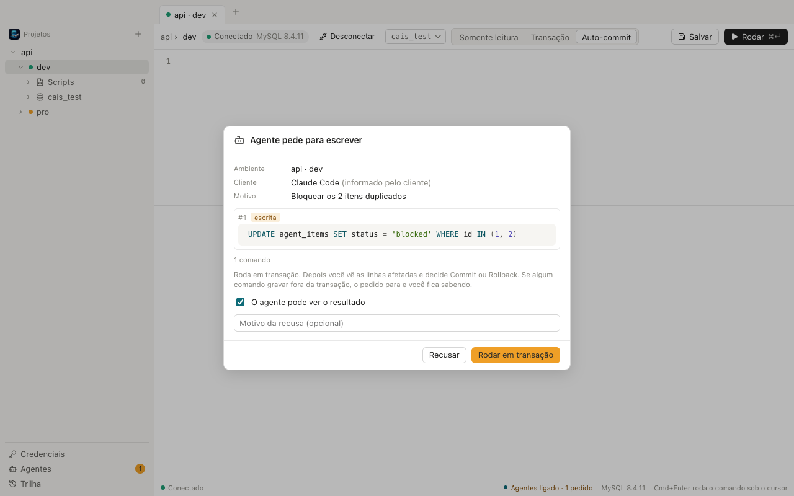
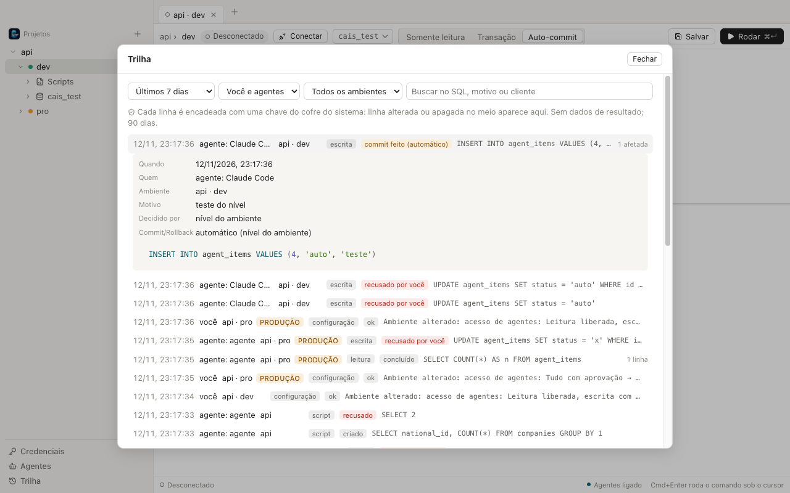

# Cais

Cais is a desktop SQL client for MySQL and, read-only, for BigQuery, built with Electron, React and TypeScript. It organizes databases by project and environment (dev, staging, production), reuses the same credential across several environments, and signs in to Google Cloud SQL through IAM with the `gcloud` account, with no proxy running on the side. It is safe by default: production opens read-only, a transaction is a tab mode and not a hidden setting, and AI agents reach the databases through a dedicated CLI (`cais llm`), with the user's approval in the app and without ever receiving a password, token or host.


## Features

- **Projects, environments and credentials.** Each project has its environments (host, port, default database, production flag). A credential is its own registry entry, used by as many environments as needed: user and password (encrypted in the system vault) or Google IAM through `gcloud`, with optional service account impersonation.
- **IAM login on Cloud SQL.** Token from `gcloud sql generate-login-token`, the `mysql_clear_password` plugin and mandatory TLS. Cais only lists the signed-in accounts and generates the token; it never changes `gcloud`.
- **BigQuery, read-only.** A BigQuery environment (Google Cloud project, optional default dataset and byte limit) uses the same Google IAM credential through `gcloud`. Tree of datasets, tables and columns, a GoogleSQL editor, and every query goes through a dry run that estimates the bytes: above the environment limit Cais asks before running, and an agent's job always carries a billed-bytes ceiling. The tab shows a fixed "Read-only" badge in place of the mode selector. Optionally, the "Estimate while typing" switch runs a dry run of the statement under the cursor at each pause (the text goes to Google every time, so it starts off): it shows "Will process X" in the status bar and the server's errors in the editor, without running the statement or recording it in the Trail. No writes, transactions or grid editing in this version (see the [roadmap](docs/roadmap.md)).
- **One session per tab, in three modes (MySQL):** Read-only, Transaction and Auto-commit. Production opens in Read-only, Auto-commit on production asks for confirmation, and closing a tab with an open transaction asks first (with Rollback as the default).
- **Read-only that holds**, in two layers: an allowlist in the app and, on MySQL, the session set to `READ ONLY` on the server, reasserted before every statement (on BigQuery, a dry run that only lets `SELECT` through).
- **SQL editor** (CodeMirror 6) with MySQL or GoogleSQL highlighting and context-aware autocomplete: the columns of the tables in the statement's `FROM` and `JOIN` (unqualified, one option per table when the name repeats), databases, tables and aliases, in the order the position calls for. On MySQL, an underline marks the syntax error while you type, without sending anything to the server.
- **Results in a virtualized grid**: up to 1,000 rows per statement, with "Fetch up to 50,000", server-side cancellation (`KILL QUERY` on MySQL), a panel with the full cell value, and copying of the value or as TSV, CSV, JSON or a Markdown table.
- **Grid editing**: change cells of a result from a single table that includes its full primary key and generate the equivalent `UPDATE` (or the `UPDATE` of one cell, with the value selected so you can replace it with an expression) or apply it in the tab itself, respecting the session mode. Rows marked for deletion (menu or Delete) become a `DELETE` by the full key, always with confirmation in Auto-commit. Selected rows become a multi-row `INSERT`, with or without the primary key.
- **Connection state in every tab** (disconnected, connecting, connected, running, error), with Connect, Reconnect and Disconnect, and disconnection after 30 minutes of inactivity (never with an open transaction).
- **Scripts saved per project**, listed inside each environment of the project, with a Save button, Cmd+S and a picker on Cmd+O.
- **Duplicate environment and project, rename project.**
- **Trail**: everything that runs in Cais, by the user and by agents, in one file per day, kept for 90 days, with each line chained by HMAC. It never stores result data.
- **Registry protection**: what decides where the credential goes and how much an agent does on its own is signed with a key from the system vault; an environment changed outside Cais opens blocked.
- **Agent access** through the `cais llm` CLI, with three levels per environment, approval in the app, the user's Commit or Rollback for writes, and writes on production always needing approval.
- **Interface in Portuguese (pt-BR) and English**, in the system language, and in a light or dark theme, following the system.

| Grid editing | Agent request |
|---|---|
|  |  |



## Requirements

- Node 20.19 or newer and npm 11.x (the lockfile changes with the npm version).
- Docker, only for `npm run integration` and `npm run e2e`: they start a `mysql:8.4` container named `cais-test-*` on a random port and remove it on their own.
- To sign in to Cloud SQL through IAM: the Google Cloud SDK (`gcloud`) installed with the account signed in, and the instance prepared (see [IAM login on Cloud SQL](docs/behavior.md#iam-login-on-cloud-sql)).
- To use BigQuery: `gcloud` with the account signed in (Cais asks `gcloud auth print-access-token` for the token), and the account with `roles/bigquery.jobUser` on the project and `roles/bigquery.dataViewer` on the datasets it reads (see [BigQuery](docs/behavior.md#bigquery-read-only)). Docker is not needed for the BigQuery tests: they use a local fake server.
- On Linux, to store passwords: a keyring with an active Secret Service (GNOME Keyring or KWallet). Without it, Cais refuses to save a password (see [Install on Linux](#install-on-linux)).

Packaging produces the app for macOS on Apple Silicon (arm64) and a `.deb` for Linux x64 (Ubuntu and derivatives), each on the matching system. There is no packaging target for Windows (the agent socket becomes a named pipe and the menu has a variant, but run from source with `npm run dev`).

## Download

The installers are on the repository's [Releases](../../releases) page, with a `SHA256SUMS.txt` to check the files.

- **Linux (Ubuntu and derivatives, x64):** `sudo apt install ./cais_<version>_amd64.deb` (see [Install on Linux](#install-on-linux)).
- **macOS (Apple Silicon):** open the `.dmg` and drag `Cais.app` to `Applications`. The app is not notarized: on first launch, use **System Settings › Privacy & Security › Open Anyway** or `xattr -dr com.apple.quarantine /Applications/Cais.app` (see [Open the unsigned app on macOS](#open-the-unsigned-app-on-macos)).

## Install and run in development

```bash
npm install
npm run dev
```

## Tests

```bash
npm run typecheck              # types, in the main and renderer projects
npm run unit                   # unit tests (no Docker)
npm run integration            # real MySQL 8.4 in a test container (needs Docker)
npm run build && npm run e2e   # end-to-end UI with Electron (opens windows; needs Docker)
npm run check                  # everything, in order: typecheck, unit, integration, build, e2e
npm run live:bigquery          # optional, not part of check: tests against the real BigQuery server
```

The e2e suite writes screenshots to `tests/e2e/screenshots/` (outside version control; the images in this README live in `docs/images/`).

The BigQuery tests never talk to Google: the driver receives the `fetch` and the address, and `tests/support/bigquery-fake.ts` is a local HTTP server. The live suite (`npm run live:bigquery`) is separate, only reads, never runs `gcloud` and skips everything without the variables `CAIS_BQ_LIVE_PROJECT` (a sandbox project) and `CAIS_BQ_LIVE_TOKEN` (for example `$(gcloud auth print-access-token)`); `CAIS_BQ_LIVE_DATASET`, `CAIS_BQ_LIVE_ROUTINE` and `CAIS_BQ_LIVE_VIEW` are optional (see the header of `tests/live/bigquery.test.ts`).

## Package

```bash
npm run dist
```

Builds the targets for the system it runs on.

On macOS (Apple Silicon):

- `dist/Cais-<version>-arm64.dmg`
- `dist/mac-arm64/Cais.app`

On Linux (x64):

- `dist/cais_<version>_amd64.deb`

### Open the unsigned app on macOS

The `.app` has only a local ad-hoc signature, with no Apple Developer ID and no notarization. Opened straight from the `dist/` folder, it runs normally. If the file goes through a download, AirDrop or another Mac, macOS quarantines it and Gatekeeper blocks the first launch:

1. Drag `Cais.app` from the `.dmg` to `Applications`.
2. Right-click the app, choose **Open** and confirm with **Open**. Or go to **System Settings › Privacy & Security** and use **Open Anyway**.
3. From the terminal: `xattr -dr com.apple.quarantine /Applications/Cais.app`.

The first time you save a password, macOS may ask for Keychain access: it is the vault where Cais keeps the encrypted passwords and the registry signing key.

### Install on Linux

```bash
sudo apt install ./dist/cais_<version>_amd64.deb
```

The package installs the app in `/opt/Cais`, the `cais-app` executable (in `/usr/bin`) and the **Cais** entry in the applications menu. The `cais` command does not come in the package: install it from the menu **File › Install cais Command in Terminal**, which creates the link in `~/.local/bin`.

- **Passwords:** the vault is the Secret Service (GNOME Keyring, KWallet). Without an available keyring, Cais refuses to save a password and the message says what to do. If the desktop environment is not recognized, open the app with `cais-app --password-store=gnome-libsecret`.
- **`gcloud`:** Cais finds `gcloud` on the PATH, through the login shell, or in `/usr/bin`, `/snap/bin` and `/usr/lib/google-cloud-sdk/bin`.
- **Chromium sandbox:** the installer sets up `chrome-sandbox` and, where AppArmor is on, installs the `cais-app` profile to allow user namespaces. The profile on Ubuntu 24.04 has not been verified yet.

## Usage

1. Under **Credentials** (bottom of the sidebar), register a credential: User and password, or Google IAM (account chosen among those signed in to `gcloud`; the database user is derived from the email and can be edited).
2. With the **+** in the sidebar, register a project and an environment with engine, host, port, default database (optional) and the credential. For BigQuery, instead of host and port: the Google Cloud project, the default dataset (optional) and the byte limit per query (100 GiB by default; empty means no limit), with a Google IAM credential. **Production** comes checked when the name is `pro`, `prod` or `production`, and can be changed. **Test connection** checks before saving.
3. Click the environment: it opens (or focuses) a tab connected to it. Write the query and run it.

The tab bar holds the environment, the connection state, the current database, the mode (Read-only · Transaction · Auto-commit), Save and Run. With an open transaction, the "Transaction open · N statements · time" bar appears with **Commit** and **Rollback**.

| Shortcut | What it does |
|---|---|
| Cmd+Enter | Runs the statement under the cursor (or the selection) |
| Cmd+Shift+Enter | Runs every statement in the editor |
| Cmd+. | Cancels the running statement |
| Cmd+T | New tab ("project · environment" picker) |
| Cmd+W | Closes the tab |
| Cmd+S / Cmd+Shift+S | Saves the script / saves as another script |
| Cmd+O | Opens a saved script |

On Linux and Windows, Ctrl takes the place of Cmd (the interface shows the shortcut for your system). The full behavior of each screen, with the reasons, is in [docs/behavior.md](docs/behavior.md).

## For agents

AI agents with a shell (Claude Code and others) query and, with your approval, fix data through the `cais llm` command. The agent **requests** and you decide in Cais; Cais does not hand a password, token or host to the command.

1. In Cais, open **Agents** (bottom of the sidebar) and turn on **Agent access**. It starts off, and while off the socket does not even exist.
2. Menu **Cais › Install cais Command in Terminal** (on Linux, the **File** menu): creates the `cais` link in `/usr/local/bin` or in `~/.local/bin`. The command runs on the system Node (20 or newer). On Windows, run `node <path>/cais.mjs`.
3. Give the agent the skill: menu **Cais › Install Agent Skill…** (on Linux, the **File** menu), which installs it for Claude Code (`~/.claude/skills`) or in a folder of your choice, where another agent keeps its skills. Or let the agent read it with `cais llm skill`, without installing anything. The file in the repository, [skills/cais/SKILL.md](skills/cais/SKILL.md), stays an alternative. In Claude Code, also allow `Bash(cais llm:*)`.

```bash
cais llm guide
cais llm envs
cais llm query shop/dev --sql "SELECT id, status FROM orders LIMIT 10"
cais llm query shop/dev --write --sql "UPDATE orders SET status = 'cancelled' WHERE id = 42" --reason "Order duplicated by the customer" --wait
```

On a BigQuery environment the agent only reads (`--write` is refused), and a read estimated above 10 GiB always waits for your approval. Each environment defines what an agent runs without asking (Everything needs approval; Reads allowed, writes need approval; Reads and writes allowed). On production, an agent write always needs approval. The full reference (commands, JSON output, exit codes, limits) is in [docs/agents.md](docs/agents.md).

## Security

- Passwords and tokens never leave the main process: the interface sends the password once, when saving, and never receives it back. Passwords stay encrypted by the system vault (Keychain on macOS, Secret Service on Linux).
- The renderer runs isolated (`contextIsolation`, `sandbox`, a restrictive CSP, no remote resources). The main process validates everything that arrives with zod and reclassifies the SQL before running it.
- Cais refuses to start with remote debugging options (only the end-to-end test hook accepts them), and the packaged app has no DevTools.
- Agents talk to Cais through a local socket owned by the user alone (mode 0600), never receive a credential, and every request is reclassified and recorded in the Trail before it runs.
- An agent without a sandbox, running as the same user, is not contained by the app. For production databases, run the agent in a sandbox and allow only `cais llm`.

The threat model, the classifier rules and the known limits are in [docs/security.md](docs/security.md).

## Documentation

| Document | Contents |
|---|---|
| [docs/behavior.md](docs/behavior.md) | How Cais behaves and why: modes, production, tabs, results, grid editing, scripts, Trail, registry |
| [docs/agents.md](docs/agents.md) | Reference for the `cais llm` CLI for agents |
| [docs/security.md](docs/security.md) | Security and threat model |
| [docs/architecture.md](docs/architecture.md) | Processes, modules, contracts, files and packaging |
| [docs/roadmap.md](docs/roadmap.md) | What is left out of the current version, with the reason, and what is left to verify |
| [AGENTS.md](AGENTS.md) | Guide for contributors to the code (people and agents) |

## Project structure

```
src/
  main/       main process: sessions, drivers, registry, vault, Trail, agent access, IPC
  preload/    typed bridge (window.cais) between the renderer and the main process
  renderer/   React interface
  shared/     pure TypeScript used by both sides: model, dialects (MySQL and GoogleSQL), IPC contract, i18n
  cli/        the cais llm command (bundled into a single file, no dependencies)
tests/        unit, integration (MySQL in a container; BigQuery on a fake server), e2e (Playwright with Electron) and live (BigQuery, optional)
scripts/      CLI packaging and the app's ad-hoc signing
skills/cais/  skill for agents to use the CLI
build/, resources/  app icons
```

To contribute, read [AGENTS.md](AGENTS.md): project rules, conventions and commands.

## License

[MIT](LICENSE).
